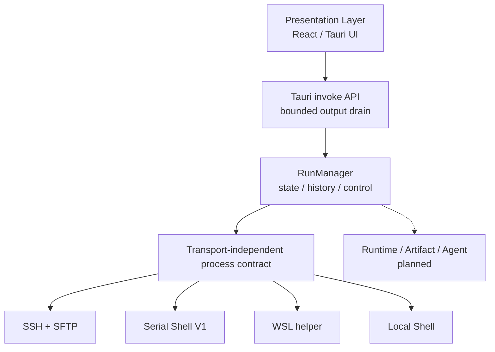
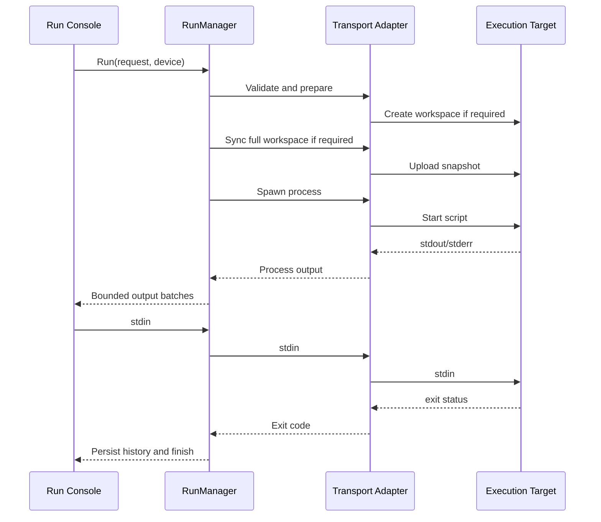
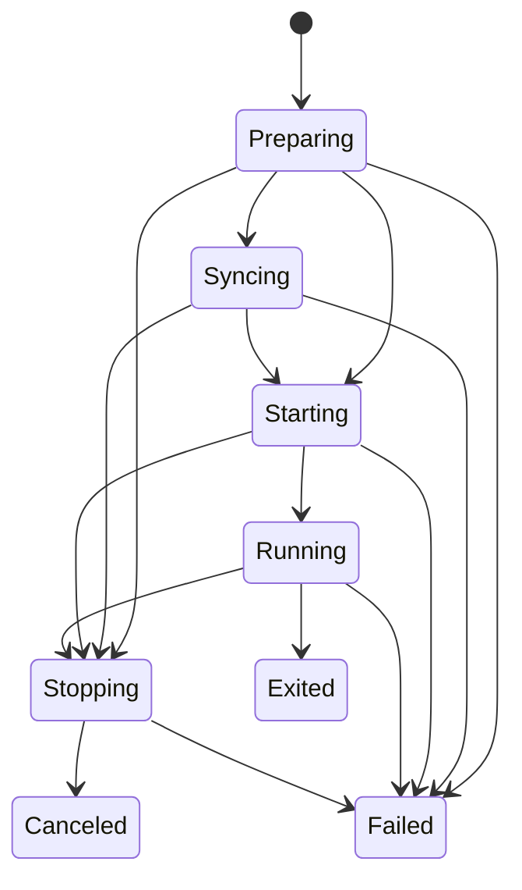
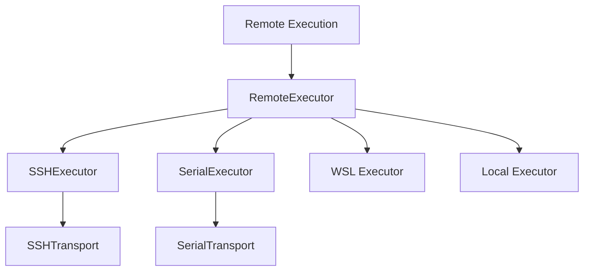
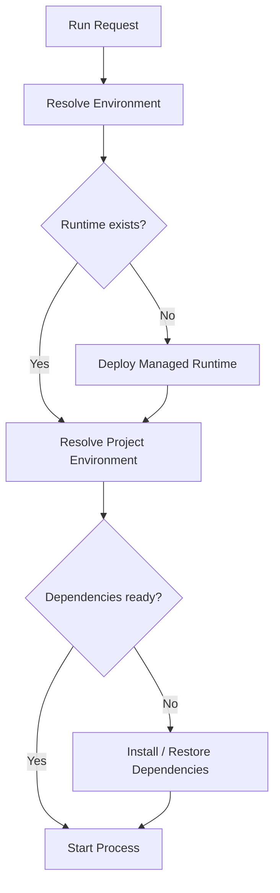
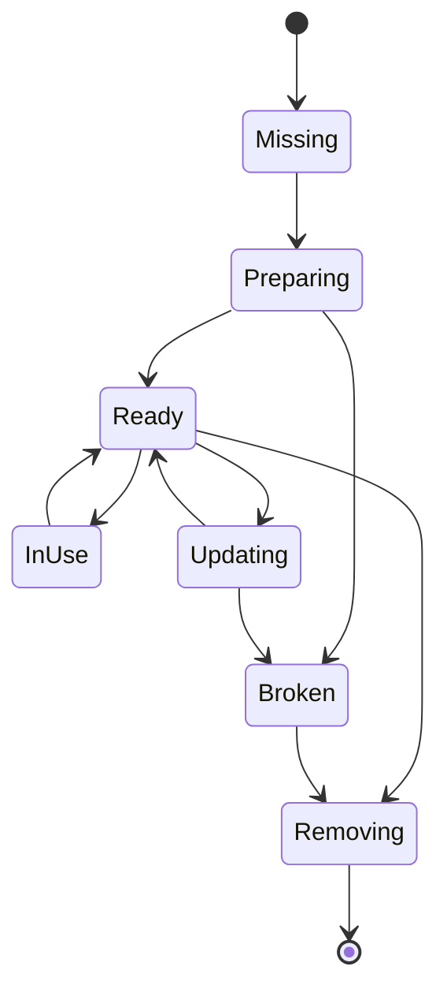
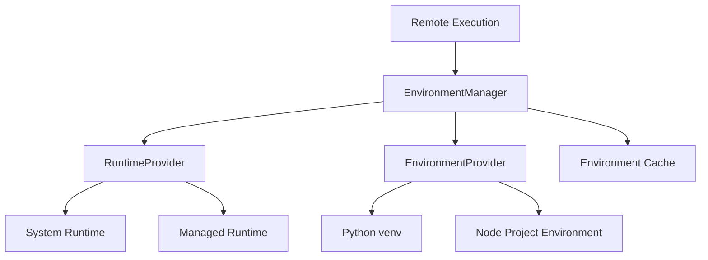
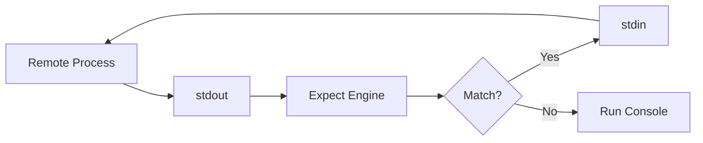
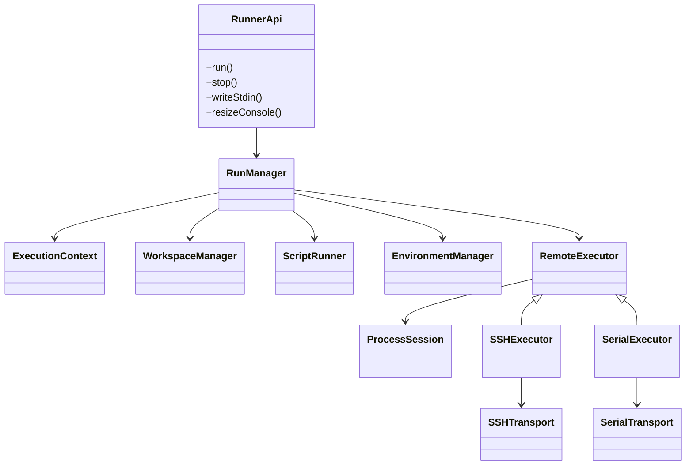

# Remote Runner
## 基于 Tauri 的跨传输脚本执行工具设计文档

> 目标：让用户像“在本地运行脚本”一样，通过 SSH、串口 Shell、WSL 或本机 Shell 执行 Python、Shell 和自定义命令，同时由统一的运行模型处理工作区、交互式输入输出、任务状态与执行历史。Node.js 专用入口、独立运行环境、Artifact 下载和 Device Agent 仍是后续目标，不属于当前已实现能力。

> 文档状态（2026-09-16）：本文保留最初的长期架构设想，并已按当前 `0.8.0` 实现修正基础架构和能力边界。标有“建议”“后续”或“目标”的内容不是完成声明；准确进度以 [实施进度](00002_20260908_implementation-progress.md) 为准，前端现状以 [前端总体设计](00025_20260915_frontend-design.md) 为准。

---

## 1. 项目背景

嵌入式 Linux 应用开发过程中，经常存在以下工作流：

- 编写 Shell / Python / Node.js 脚本；
- 将脚本上传到目标设备；
- 通过 SSH 或串口登录目标设备；
- 设置环境变量；
- 进入指定目录；
- 激活 Python / Node 环境；
- 运行脚本；
- 与脚本进行交互；
- 查看 stdout / stderr；
- 复制日志；
- 下载脚本生成的结果文件；
- 清理临时目录。

传统工具通常把这些行为拆散到多个程序中：

- SSH Terminal；
- 串口 Terminal；
- SCP / SFTP；
- 编辑器；
- Python 虚拟环境；
- Node.js 版本管理；
- 日志查看器。

本项目希望将它们统一成一个脚本运行器。除远程设备外，也支持本机 WSL 发行版和本机 Shell；“设备”在代码中是执行目标的统一抽象，不限定为嵌入式硬件。

用户面对的核心概念不是：

> “我要登录远程设备。”

而是：

> “我要在某个目标设备上运行这个本地脚本。”

---

# 2. 产品定位

产品名称与定位为：

**Remote Runner**

核心体验：

```text
选择本地脚本
    ↓
选择目标设备
    ↓
设置运行参数（运行环境管理为后续能力）
    ↓
点击 Run
    ↓
在 Run Console 中与程序交互
    ↓
查看结果
```

在“运行”主流程中，用户无需感知：

- SSH shell；
- root prompt；
- `/tmp/...` 临时目录；
- SFTP；
- PTY；
- 串口 shell prompt；
- heredoc；
- marker；
- runtime 解压路径；
- Python venv 激活命令。

这些都属于系统内部实现。应用另提供独立交互终端作为辅助能力，但它与 Run Console、RunManager 和工作区运行相互独立；串口当前不支持独立终端。

---

# 3. 核心设计原则

## 3.1 运行主流程屏蔽远程 Terminal

GUI 不把“SSH Terminal”作为脚本运行的主要交互入口。

用户看到的是：

- Script Editor；
- Run Console；
- Task / Run History；
- Device Selector；
- Runtime / Environment Selector。

例如：

```text
▶ test_audio.py

Initializing audio subsystem...
HDMI RX detected.

Please select input:
1. HDMI0
2. HDMI1

> _
```

而不是：

```text
root@rk3588:/tmp/devrunner/45a4c2# python3 test_audio.py
```

---

## 3.2 Run Console 绑定的是“远程进程”，不是“远程 Shell”

Run Console 的语义：

> 当前正在运行的脚本或程序的 stdin/stdout/stderr。

而不是：

> SSH 登录之后的交互式 Shell。

因此一次运行对应一个明确的 `ProcessSession`。

---

## 3.3 Remote Execution 隐藏底层传输差异

上层使用统一接口：

```text
run
writeStdin
stop
resizeConsole
downloadArtifact
```

当前已实现 `run`、`writeStdin`、`stop` 和按能力支持的 `resizeConsole`；`downloadArtifact` 仍是规划接口。

底层可以是：

- SSH；
- Serial；
- WSL；
- Local Shell；
- 后续的 Device Agent；
- ADB；
- USB；
- WebSocket；
- 其他自定义协议。

---

## 3.4 环境是执行任务的一等公民（目标设计，Python 已实现）

长期目标是让脚本不必默认依赖目标系统的全局：

```text
/usr/bin/python3
/usr/bin/node
/usr/lib/python...
```

长期目标是让每个 Workspace / Script Task 可以绑定自己的运行环境。Python 的 Runtime / Environment 模型已实现：uv-only Managed Python Runtime（固定 uv + 固定 CPython patch + `uv.lock` 内容寻址环境，SSH / WSL / Local 支持，Serial 明确不支持），设计与实施记录见 `docs/00027_20260916_uv-managed-python-runtime.md` 与 `docs/00028_20260916_uv-runtime-implementation-progress.md`。Node 与容器环境仍未实现；未启用托管模式时仍直接使用执行目标中可用的系统解释器或用户自定义命令。

例如：

```text
audio-test
  └── Python 3.12 Runtime
      └── venv
          ├── numpy
          ├── requests
          └── pyyaml
```

或者：

```text
web-test
  └── Node.js 22 Runtime
      └── node_modules
```

---

# 4. 技术栈

当前选型：

## Frontend

- Tauri 2
- React
- TypeScript
- xterm.js
- CodeMirror 6
- Zustand
- i18next / react-i18next

## Backend

- Rust
- Tokio
- serde
- tracing
- uuid
- russh / russh-sftp
- tokio-serial
- portable-pty
- JSON 文件 + localStorage 持久化

当前组合为：

```text
Tauri 2
React + TypeScript
xterm.js
CodeMirror 6

Rust
Tokio
russh
tokio-serial
serde
tracing
JSON / localStorage
```

---

# 5. 总体架构



---

# 6. 分层设计

长期设计可以分为六个层次：

```text
Presentation
    ↓
Runner API
    ↓
Remote Execution
    ↓
Runtime / Environment Management
    ↓
Remote Executor
    ↓
Transport
```

各层职责必须保持清晰。

当前已实现 Presentation → Tauri API → RunManager / process contract → transport-specific adapter；Runtime / Environment 层尚不存在，Remote Executor 也不是单一 trait，而是四个传输模块的共同约定。

---

# 7. Presentation Layer

Presentation Layer 是用户直接看到的部分。

主要组件：

```text
Device List
Workspace Explorer
Script Editor
Run Console
Run History
Preset Commands
Independent Terminal Tabs
Task Status
Menu / Layout / Update UI
```

`Environment Manager` 仍是后续模块。当前编辑器使用 CodeMirror 6，支持目录树、文件增删改、冲突检测、多标签、保存和未保存保护；布局由面板注册表驱动。

概念 UI（Runtime 区域属于后续能力）：

```text
┌──────────────────────────────────────────────────────────────┐
│ Device: RK3588-Lab        Runtime: System / future managed  │
├───────────────┬──────────────────────────────────────────────┤
│ Workspace     │ test_audio.py                               │
│               │                                              │
│ test_audio.py │ print("HDMI test")                           │
│ config.yaml   │ ...                                          │
│ data/         │                                              │
│               │                              [▶ Run]          │
├───────────────┴──────────────────────────────────────────────┤
│ Run Console                                                  │
│                                                              │
│ HDMI Test Tool                                               │
│                                                              │
│ Select input:                                                │
│ 1. HDMI0                                                     │
│ 2. HDMI1                                                     │
│ > _                                                          │
│                                                              │
│ [■ Stop]                                    Running          │
└──────────────────────────────────────────────────────────────┘
```

---

# 8. Runner API

Runner API 是 Frontend 与核心执行系统之间的唯一入口。

当前运行 API：

```text
run_script()
stop_run()
send_run_input()
resize_run_console()
get_run_status()
list_running_runs()
get_run_history()
export_run_record()
export_run_output()
clear_run_history()
drain_run_events()
```

设备、工作区、独立终端和应用更新另有各自的 invoke 命令。Artifact 枚举和下载尚未实现，不能与“导出本地持久化的运行输出”混为一谈。

例如：

```rust
run_script(RunRequest {
    device_id,
    workspace_dir,
    kind,
    entry,
    command,
    args,
    env,
    console_mode,
    timeout_secs,
}) -> RunId
```

前端只知道 `RunId`。

后续所有事件都围绕 RunId。

---

# 9. Remote Execution

## 9.1 定义

Remote Execution 是整个系统的核心。

推荐正式定义：

> Remote Execution 是负责将本地 Run 请求转换为执行目标上的实际进程，并管理工作空间同步、进程创建、标准输入输出、交互式会话、退出状态和取消的执行层。运行环境准备与资源清理是后续扩展职责。

它对上隐藏：

- SSH；
- Serial；
- WSL；
- Local Shell；
- SFTP；
- Shell；
- PTY；
- 远程路径；
- runtime 安装目录。

它对下隐藏：

- GUI；
- Editor；
- Run Button；
- Run Console。

---

## 9.2 一次 Run 的当前过程



Local Shell 跳过创建/上传步骤并在工作区原地运行。当前没有 Runtime resolve 或运行结束后的目标目录 Cleanup。

---

# 10. Remote Execution 内部模块

长期建议拆分为：

```text
Remote Execution
├── RunManager
├── ExecutionContext
├── WorkspaceManager
├── ScriptRunner
├── FileSync
├── ProcessSession
├── EnvironmentManager
├── ArtifactManager
└── CleanupManager
```

当前实现没有为了未落地能力建立空模块：`runner.rs` 负责 RunManager 与分派，`process.rs` 定义传输无关的状态、能力和会话控制，`ssh/`、`serial/`、`wsl/`、`local/` 各自封装协议与进程会话。`EnvironmentManager`、`ArtifactManager` 和 `CleanupManager` 尚未实现。

---

# 11. RunManager

RunManager 管理所有正在执行和已经执行的任务。

例如：

```rust
struct Run {
    id: RunId,
    device_id: DeviceId,
    workspace_id: WorkspaceId,
    // environment_id: EnvironmentId, // planned
    state: RunState,
}
```

一个用户可以同时运行：

```text
Run #101 → RK3588-A
Run #102 → RK3588-B
Run #103 → COM8
```

RunManager 负责：

- 分配 RunId；
- 保存状态；
- 转发 stdout/stderr；
- 处理 cancel；
- 保存历史；
- 持久化最多 2 MiB 的单次运行输出；
- 处理事件缺口后的状态重同步。

当前不会在应用重启后恢复仍在远端运行的进程；“异常恢复”仅限状态/历史一致性与前端事件重同步，不应理解为跨进程接管。

---

# 12. ExecutionContext

概念上每次 Run 都有独立的执行上下文。当前实现由已校验的 `RunRequest`、`DeviceProfile`、`run_id`、控制通道和各传输的局部状态共同承载，并没有名为 `ExecutionContext` 的结构体。

例如：

```rust
struct ExecutionContext {
    run_id: RunId,
    device: DeviceProfile,
    workspace: RemoteWorkspace,
    runtime: RuntimeInstance,     // planned
    env: EnvironmentInstance,    // planned
    command: SpawnRequest,
}
```

ExecutionContext 是一次执行过程中各模块共享的信息容器。

---

# 13. WorkspaceManager

负责把选定 Workspace 映射到执行目标。SSH、Serial 和 WSL 每次运行都使用独立目录；Local Shell 直接在本地工作区原地运行，不复制文件；工作区位于设备上且运行目标就是该设备时同样原地运行。

本地：

```text
D:\embedded\audio-test
├── test.py
├── config.yaml
└── assets/
```

远程：

```text
/tmp/devrunner/workspaces/7f1a93
├── test.py
├── config.yaml
└── assets/
```

映射关系：


运行界面要求用户选择一个工作区：本机目录，或某台 SSH/WSL 设备上的目录（`WorkspaceRef`，见 `docs/00029_20260917_remote-workspace.md`）。SSH/Serial/WSL 的目标工作区路径是内部细节；Local Shell 的产物直接落在本地工作区。

当工作区位于设备上时：

- 运行目标就是该设备 → **原地运行**（不复制文件，产物留在工作区）：SSH 直接使用该目录，WSL 由 helper 打开已存在目录；
- 运行目标是另一台设备 → 先把源工作区下载到本机暂存目录 `%TEMP%\remote-runner-stage-<run_id>`，再按目标 transport 走下方 FileSync 的常规路径，运行结束清理暂存目录。

---

# 14. FileSync

FileSync 负责同步运行需要的文件。

V1 推荐：

```text
每次 Run
    ↓
创建临时 Workspace
    ↓
上传全部必要文件
```

V2 再支持增量同步：

```text
size
mtime
hash
```

当前仍是每次运行收集并全量传输，没有增量同步。SSH/WSL 支持有界二进制快照，Serial Shell V1 仅支持有界 UTF-8 文本；Local Shell 不同步。

工作区位于设备上时同步方向由「工作区 → 运行目标」决定：先在编辑 / 暂存会话内把源工作区读到本机暂存目录，再按目标 transport 上传；限额沿用上传策略（单文件 64 MiB、总量 256 MiB、4096 条目、跳过 `.git` 等与符号链接）。

同步内容：

- entry script；
- 配置文件；
- 数据文件；
- assets；
- 本地依赖；
- 可执行程序。

---

# 15. ScriptRunner

ScriptRunner 负责回答：

> 这个任务应该以什么方式启动？

例如：

## Python

```text
python3 -u ./test.py
```

## Shell

```text
/bin/bash ./test.sh
```

## Node（未提供专用 ScriptKind）

```text
node ./test.js
```

## Binary（未提供专用 ScriptKind）

```text
./decoder_test
```

## 自定义命令

```text
gst-launch-1.0 ...
```

推荐数据结构：

```rust
enum RuntimeType {
    Python,
    Node,
    Shell,
    Binary,
    Custom,
}
```

当前 `ScriptKind` 只有 `Python`、`Shell`、`Command`。Node、二进制及其他工具可以由用户通过 Command 模式调用，但没有专用入口校验、运行时解析或环境管理。

---

# 16. ProcessSession

ProcessSession 是一次实际远程进程的运行实例。

它是整个系统最重要的运行时对象之一。

```rust
struct ProcessSession {
    id: RunId,
    state: ProcessState,
    exit_code: Option<i32>,
}
```

它管理：

```text
stdin
stdout
stderr
resize
signal
exit
```

GUI 中的 Run Console 实际上就是 ProcessSession 的可视化。

---

# 17. Run State Machine

当前状态机：



当前没有 `PreparingEnvironment`、`Cleaning` 或 `Finished` 状态，因为环境准备与远端工作区清理尚未实现。`Exited`、`Canceled`、`Failed` 是直接持久化的终态。

---

# 18. Run Console

Run Console 不是 SSH Terminal。

它显示：

```text
Process stdout
Process stderr
Process input
Run status
```

例如：

```text
▶ test_audio.py

Initializing...

Select test mode:
1. Playback
2. Capture
3. Loopback

> _
```

底层可能使用 xterm.js，但产品语义必须叫：

```text
Run Console
```

而不是：

```text
SSH Terminal
```

---

# 19. 为什么仍然使用 xterm.js

即使 Run Console 不等同于远程 Terminal，xterm.js 仍然非常适合进程控制台。应用也复用 xterm.js 提供独立的 SSH / WSL / Local Shell 终端标签；两类会话由不同的 store 和后端 manager 管理。

因为脚本可能输出：

- ANSI color；
- 光标控制；
- progress bar；
- TUI；
- `input()`；
- readline；
- ncurses；
- `top`；
- `menuconfig`。

Run Console 可以是：

```text
xterm.js
   ↕
ProcessSession
```

而不是：

```text
xterm.js
   ↕
SSH Login Shell
```

---

# 20. PTY 模型

交互式程序在很多情况下需要 TTY。

例如：

```python
sys.stdin.isatty()
```

或者：

```bash
[ -t 0 ]
```

当前 RunRequest 可以定义：

```yaml
console_mode: pty
```

支持：

```text
pipe
pty
```

默认是 `pty`。SSH、WSL、Local 支持 pipe / pty 和运行中 resize；Serial Shell V1 只有合并输出的 PTY-like 会话，不支持 pipe 和运行中 resize。`none` / `auto` 尚未实现。

### pipe

适用于：

- 自动化脚本；
- 日志采集；
- 非交互程序。

### pty

适用于：

- input；
- readline；
- ncurses；
- 彩色输出；
- 交互式 CLI。

# 21. SSH Executor

SSH Executor 建议提供：

```text
prepareWorkspace
upload
download
spawnPipe
spawnPty
signal
remove
```

当前已实现 workspace prepare/upload、pipe/PTY spawn、输入/resize/分级停止；通用 download、运行目录 remove 和 Artifact API 尚未实现。

底层：

```text
SSH
├── Exec Channel
├── PTY Channel
└── SFTP
```

交互脚本：


重要原则：

**SSH Channel 通过 exec 请求启动一次有边界的包装命令，而不是打开登录 Shell 后模拟键盘输入。** 包装层用 shell 文件处理工作目录、环境变量、PID/进程组与退出码，随后 `exec` 目标程序；因此不会把交互式 shell prompt 混入 Run Console。

这样可以避免：

```text
root@device:~#
```

进入 Run Console。

---

# 22. Serial Executor

Serial 只有：

```text
read
write
```

因此 V1 需要在其上实现一个轻量 Shell Execution Protocol。

---

## 22.1 命令完成检测

不要依赖：

```text
#
$
root@
```

而是使用每次运行独有的随机 nonce marker。当前协议还用 RS (`0x1e`) / US (`0x1f`) 定界，按原始字节解析并剥离 prompt/echo，不使用下面的可打印示例作为真实帧格式。

例如：

```bash
printf '__RUN_BEGIN_f83c1__\n'
python3 -u /tmp/test.py
__rc=$?
printf '__RUN_END_f83c1__:%d\n' "$__rc"
```

解析状态：

```text
WAIT_BEGIN
    ↓
RUNNING
    ↓
WAIT_END
    ↓
FINISHED
```

---

## 22.2 Serial 脚本上传

当前实现把每个 UTF-8 文本文件按最多 3 KiB 分块，base64 编码后通过带引号的 heredoc 逐块创建/追加，并等待每块命令确认；这样同时保留无末尾换行的内容并避开单个 shell 参数上限。例如概念上是：

```bash
base64 -d > /tmp/devrunner/test.py <<'RR_UPLOAD_EOF'
cHJpbnQoImhlbGxvIikK
RR_UPLOAD_EOF
```

然后：

```bash
python3 -u /tmp/devrunner/test.py
```

---

## 22.3 后续 Device Agent

串口长期使用时，推荐升级为：

```text
Windows GUI
     ↓
Remote Execution
     ↓
SerialAgentExecutor
     ↓
Serial Transport
     ↓
devrunner-agent
     ↓
Process
```

Agent 协议：

```text
SPAWN
STDIN
STDOUT
STDERR
RESIZE
SIGNAL
EXIT
UPLOAD_BEGIN
UPLOAD_DATA
UPLOAD_END
DOWNLOAD
```

这样可以彻底摆脱 shell prompt、echo、marker、heredoc。

---

# 23. Transport Layer

Transport 只负责最基础的通信。

## SSH Transport

只关心：

```text
connect
disconnect
openChannel
read
write
sftp
```

## Serial Transport

只关心：

```text
open
close
read
write
setBaudrate
```

## WSL Bridge

通过结构化 `wsl.exe` 参数启动发行版内的内嵌 Python helper，使用独立控制协议传递二进制工作区、PTY/pipe 输出、输入、resize、停止和明确的退出消息，不依赖 SSH 服务。

## Local Shell

通过 `portable-pty` 或独立管道直接启动本机 shell。工作区原地运行，不经过上传；不同 shell flavor 分别构造 argv，避免把路径和脚本内容拼接为同一条 shell 命令。

Transport 不知道：

- Script；
- Workspace；
- Run；
- Python；
- Environment；
- Run Console。

---

# 24. Remote Executor

在 Transport 上面增加一层执行适配。当前没有单一 `RemoteExecutor` trait；`RunManager` 按 `TransportKind` 分派到四个模块，并通过 `process.rs` 的状态、输出与控制消息保持共同契约。



建议接口：

```rust
trait RemoteExecutor {
    async fn prepare_workspace(...);
    async fn upload(...);
    async fn spawn(...) -> Result<ProcessSession>;
    async fn cleanup(...);
}
```

---

# 25. Runtime / Environment Management（后续目标，当前未实现）

这是长期规划的重要能力。当前代码中没有 Runtime、Environment、Dependency、EnvironmentManager 或 RuntimeManager；Python 和 Shell 入口直接使用执行目标可用的系统解释器，Command 模式由用户显式指定命令。

Python Managed Runtime 的后续实现已确定采用 uv-only 模型，不提供系统 Python/venv fallback；完整设计见 [00027 uv-only Managed Python Runtime](00027_20260916_uv-managed-python-runtime.md)。本节后续内容保留最初的通用 Runtime 设想，如与 00027 冲突，以 00027 的 Python 专项决策为准。

目标：

> 同一个脚本在不同 Linux 固件、不同系统 Python、不同 Node.js 安装情况下，尽可能保持一致的执行环境。

建议引入：

```text
Runtime
Environment
Dependency
EnvironmentManager
RuntimeManager
```

---

# 26. Runtime 与 Environment 的区别

建议明确区分。

## Runtime

表示语言运行时本身。

例如：

```text
Python 3.11.9
Python 3.12.4
Node.js 20
Node.js 22
```

## Environment

表示基于 Runtime 创建的某个项目环境。

例如：

```text
Python 3.12
    ↓
audio-test-env
    ├── numpy
    ├── pyyaml
    └── requests
```

或者：

```text
Node.js 22
    ↓
web-test-env
    └── node_modules
```

---

# 27. 环境隔离等级

建议支持四种 Environment Mode。

---

## 27.1 System Runtime

直接使用目标系统环境：

```text
/usr/bin/python3
/usr/bin/node
```

优点：

- 无准备成本；
- 占用空间最少。

缺点：

- 固件差异大；
- Python 版本不可控；
- Node 版本不可控；
- 系统包容易互相影响。

适合作为 fallback。

---

## 27.2 Project Environment

使用系统 Runtime，但创建项目级虚拟环境。

Python：

```text
/usr/bin/python3
    ↓
venv
    ↓
.devrunner/envs/audio-test/
```

Node：

```text
system node
    ↓
project node_modules
```

优点：

- 隔离第三方依赖；
- 体积相对小。

缺点：

**无法隔离 Runtime 本身。**

例如 Python venv 仍依赖目标系统 Python：

```text
Python 3.8 venv
```

不会自动变成：

```text
Python 3.12
```

因此不能完全解决不同固件的 Runtime 差异。

---

# 28. Managed Runtime

这是推荐的默认高级方案。

由本工具管理独立的 Runtime。

例如：

```text
/opt/devrunner/
└── runtimes/
    ├── python/
    │   ├── 3.11.9/
    │   └── 3.12.4/
    │
    └── node/
        ├── 20.18/
        └── 22.12/
```

项目环境：

```text
/opt/devrunner/
└── environments/
    ├── audio-test/
    │   └── python-3.12/
    └── web-test/
        └── node-22/
```

执行：

```text
/opt/devrunner/runtimes/python/3.12/bin/python
```

而不是：

```text
/usr/bin/python3
```

这样目标系统差异被大幅削弱。

---

# 29. Managed Runtime 工作流程



---

# 30. Runtime Bundle

可以维护预构建 Runtime Bundle。

例如：

```text
python-3.12.4-linux-aarch64.tar.zst
node-22.12-linux-aarch64.tar.zst
```

Runtime metadata：

```yaml
runtime:
  type: python
  version: 3.12.4
  arch: aarch64
  os: linux
```

RuntimeManager 根据目标设备：

```text
arch
glibc
kernel
ABI
```

选择合适 bundle。

---

# 31. Runtime Compatibility

必须注意：

所谓 Managed Runtime 并不能完全脱离 Linux 系统。

仍然可能依赖：

```text
glibc
libstdc++
kernel ABI
dynamic loader
shared libraries
```

因此 RuntimeManager 应检测：

```text
uname -m
ldd --version
/lib/ld-linux-*
```

并生成：

```text
DeviceRuntimeProfile
```

例如：

```yaml
arch: aarch64
libc: glibc
glibc_version: 2.31
kernel: 5.10
```

Runtime Bundle 根据 profile 匹配。

---

# 32. Python Environment

建议 Python 支持：

```text
Managed Python Runtime
        ↓
venv
        ↓
requirements
```

结构：

```text
/opt/devrunner/
├── runtimes/
│   └── python-3.12.4/
│
└── envs/
    └── audio-test/
        └── .venv/
```

执行：

```text
/opt/devrunner/envs/audio-test/.venv/bin/python -u test.py
```

不需要：

```bash
source .venv/bin/activate
```

Remote Execution 直接调用完整解释器路径。

这是更加稳定的做法。

---

# 33. Python 依赖描述

可以支持：

```text
requirements.txt
```

或者：

```yaml
environment:
  runtime:
    type: python
    version: "3.12"

  dependencies:
    requirements: requirements.txt
```

EnvironmentManager 自动：

```text
创建 venv
    ↓
pip install
    ↓
缓存环境
```

后续 Run 直接复用。

---

# 34. Node.js Environment

推荐：

```text
Managed Node Runtime
        ↓
project node_modules
```

例如：

```text
/opt/devrunner/runtimes/node/22/bin/node
```

项目：

```text
/tmp/devrunner/workspaces/xxx/
├── package.json
├── package-lock.json
└── node_modules/
```

执行：

```text
/path/to/node test.js
```

后续可以支持：

```text
npm
pnpm
yarn
```

但 V1 建议只支持 npm。

---

# 35. Environment Definition

建议项目拥有：

```text
runner.yaml
```

例如：

```yaml
name: HDMI Audio Test

entry: test_audio.py

runtime:
  type: python
  version: "3.12"

environment:
  isolation: managed

dependencies:
  requirements: requirements.txt

arguments:
  - --device
  - hdmi

env:
  GST_DEBUG: "2"
  GLOG_logtostdout: "1"

console:
  mode: pty

timeout: 120
```

---

# 36. Node 示例

```yaml
name: WebSocket Test

entry: index.js

runtime:
  type: node
  version: "22"

environment:
  isolation: managed

dependencies:
  npm: true

console:
  mode: pipe
```

---

# 37. Environment Cache

环境准备成本可能较高，因此需要缓存。

可以计算：

```text
EnvironmentKey =
    runtime version
    +
    dependency file hash
    +
    architecture
```

例如：

```text
python:3.12
requirements.txt SHA256
aarch64
```

得到：

```text
env-31bd04a
```

如果已经存在：

```text
直接复用
```

否则：

```text
创建新环境
```

---

# 38. Environment Lifecycle



---

# 39. EnvironmentManager

建议职责：

```text
detectDeviceProfile
resolveRuntime
installRuntime
verifyRuntime
createEnvironment
installDependencies
reuseEnvironment
removeEnvironment
listEnvironments
```

EnvironmentManager 不是 ScriptRunner 的附属组件，而应该是独立子系统。

---

# 40. 环境管理整体架构



---

# 41. 为什么不依赖 activate

远程执行不要这样：

```bash
source .venv/bin/activate
python test.py
```

而应该：

```bash
/path/to/.venv/bin/python test.py
```

Node 同理：

```bash
/path/to/node test.js
```

原因：

- 不依赖 shell 类型；
- 不依赖 `.bashrc`；
- 不依赖环境激活脚本；
- command 构造更稳定；
- 对 SSH exec 更友好。

---

# 42. Native Dependency 问题

Python 包可能包含：

```text
numpy
opencv
cryptography
```

这些可能依赖：

```text
glibc
libstdc++
OpenSSL
GPU
RKNN
RGA
MPP
```

所以 Managed Python Runtime 并不代表所有 Python 包都完全可移植。

建议 EnvironmentManager 把依赖分成：

```text
Pure Language Dependencies
Native Dependencies
System Dependencies
```

例如：

```yaml
dependencies:
  python:
    requirements: requirements.txt

  system:
    required:
      - librga.so
      - librockchip_mpp.so
```

Remote Execution 执行前检查，但不一定负责自动安装系统级库。

---

# 43. Container Mode

未来可以增加第四种隔离方式：

```text
Container Environment
```

例如设备支持：

```text
Docker
Podman
```

运行：

```text
docker run ...
```

这样可以获得更强的环境隔离。

但是很多嵌入式设备：

- 没有 Docker；
- 存储有限；
- 与 GPU / V4L2 / DRM / RGA / MPP 集成复杂。

因此不建议作为第一版默认方案。

---

# 44. 推荐的环境优先级

建议：

```text
Managed Runtime + Project Environment
        ↑
        │ 推荐默认
        │
Project Environment
        ↑
        │
System Runtime
```

Container 作为高级选项。

---

# 45. Device Profile

当前设备配置保存在 `devices.json`，统一字段包括 `id`、`name`、`is_default`、`transport` 和 `workspace_root`，再按传输保存：

- SSH：host、port、username、密码或私钥认证；
- Serial：port、baud rate；
- WSL：distribution、可选 user；
- Local：shell id、可选绝对可执行路径。

下面的 runtime/capabilities 配置是后续目标，不是当前文件格式：

```yaml
name: RK3588-Lab

transport:
  type: ssh
  host: 192.168.50.102
  port: 22
  username: root

runtime_root:
  /opt/devrunner

workspace_root:
  /tmp/devrunner

capabilities:
  managed_runtime: true
  python: true
  node: true
```

串口：

```yaml
name: RK3588-UART

transport:
  type: serial
  port: COM8
  baudrate: 1500000

runtime_root:
  /opt/devrunner
```

---

# 46. Capability Model

不同 Transport / Device 能力不同。

长期建议：

```text
EXEC
PTY
UPLOAD
DOWNLOAD
FILE_SYSTEM
MANAGED_RUNTIME
AGENT
```

例如：

```text
SSH:
    EXEC
    PTY
    UPLOAD
    DOWNLOAD
    FILE_SYSTEM

Serial Shell:
    EXEC
    PTY-like
    UPLOAD_TEXT

Serial Agent:
    EXEC
    PTY
    UPLOAD
    DOWNLOAD
    FILE_SYSTEM
```

Remote Execution 根据 Capability 自动选择策略。

当前只实现了运行所需的两个静态能力位：`pipe` 和 `resize`。Serial 两者均为 false，SSH / WSL / Local 两者均为 true；UPLOAD、DOWNLOAD、MANAGED_RUNTIME、AGENT 尚未形成通用能力模型。

---

# 47. Ctrl+C 与 Stop

用户看到：

```text
[■ Stop]
```

内部可能：

```text
SIGINT
    ↓
wait
    ↓
SIGTERM
    ↓
wait
    ↓
SIGKILL
```

PTY：

```text
Ctrl+C = 0x03
```

Agent 模式（后续目标）：

```text
SIGNAL(SIGINT)
```

GUI 不需要知道具体机制。

---

# 48. Expect / 自动应答（后续目标，当前未实现）

可以增加：

```text
ExpectEngine
```

监听 ProcessSession 输出。

例如：

```yaml
expect:
  - pattern: "Continue\\? \\[y/N\\]"
    send: "y\n"

  - pattern: "Select device:"
    send: "1\n"
```

流程：



---

# 49. 输出与日志

当前每次 Run 在 `history.json` 保存：

```text
RunId
Device
Label
State
StartTime
EndTime
ExitCode
Error
OutputBytes
OutputTruncated
```

原始输出按运行保存到 `run_logs/<run_id>.log`，单次上限 2 MiB，并可从历史面板导出；历史上限为 200 条，淘汰或清空历史时同步清理日志。PTY/Serial 的输出本来就是合并流，日志文件也不额外写入 stdout/stderr 结构化标签。Runtime、Environment 和 Artifacts 元数据尚不存在。

`run_logs` 只保存用户进程的原始输出字节，不添加时间戳、设备、状态或 stream 前缀；结构化状态在 `history.json` 中单独保存。Rust `tracing` 调试日志与用户 Console 日志分开。

---

# 50. Artifact（后续目标，当前未实现）

脚本可能产生：

```text
log.txt
capture.jpg
result.json
trace.bin
```

Script 定义：

```yaml
artifacts:
  - "*.log"
  - "result.json"
  - "captures/*"
```

运行结束：

```text
Remote Artifact
      ↓
ArtifactManager
      ↓
Local Workspace / Run History
```

---

# 51. Tauri 前后端通信

普通命令使用 `invoke`：

```text
run_script
stop_run
send_run_input
resize_run_console
```

运行输出没有使用原生 Tauri Event 直接推送到 WebView。后端写入有界 broadcast 队列，前端约每 33 ms 单飞行调用 `drain_run_events` 拉取一批事件；接收方落后时返回 `resync` 状态快照并标记输出缺口，避免无界 IPC 堆积。

事件：

```text
output { run_id, stream, data: base64 }
status { status }
resync { statuses }
```

`output` 直接携带 `run_id`，`status` 的 `RunStatus` 携带 `run_id`，`resync` 则携带多个 `RunStatus`。独立终端通过 `read_terminal` 使用另一套有界拉取协议。Artifact 与 environment 事件尚未实现。

---

# 52. Rust 核心接口目标

以下 trait 是环境/Artifact 能力扩展后的目标形态，当前未按这些名称落地。现有公共契约集中在 `process.rs` 的 `ExecutionEvent`、`SessionEvent`、`SessionControl`、`Outcome` 和 `Capabilities`，由 `RunManager` 调度具体传输。

```rust
pub trait RemoteExecutor {
    async fn prepare_workspace(
        &self,
        context: &ExecutionContext,
    ) -> Result<RemoteWorkspace>;

    async fn upload(
        &self,
        local: &Path,
        remote: &RemotePath,
    ) -> Result<()>;

    async fn spawn(
        &self,
        request: SpawnRequest,
    ) -> Result<ProcessSession>;

    async fn cleanup(
        &self,
        context: &ExecutionContext,
    ) -> Result<()>;
}
```

环境：

```rust
pub trait RuntimeProvider {
    async fn resolve(
        &self,
        request: RuntimeRequest,
        device: &DeviceProfile,
    ) -> Result<RuntimeInstance>;
}
```

---

# 53. Rust 工程结构

当前结构按已实现能力组织：

```text
src-tauri/src/
├── commands.rs / device.rs / runner.rs / process.rs
├── workspace.rs / workspace_upload.rs
├── terminal.rs / events.rs
├── ssh/
├── serial/
├── wsl/
├── local/
├── tray.rs
└── update.rs
```

下面是能力继续扩展后的目标拆分；不应据此查找当前不存在的目录：

```text
src-tauri/src/
├── app/
│   └── state.rs
│
├── device/
│   ├── manager.rs
│   ├── profile.rs
│   └── capability.rs
│
├── transport/
│   ├── mod.rs
│   ├── ssh.rs
│   └── serial.rs
│
├── executor/
│   ├── mod.rs
│   ├── ssh_executor.rs
│   ├── serial_shell_executor.rs
│   └── serial_agent_executor.rs
│
├── execution/
│   ├── run_manager.rs
│   ├── execution_context.rs
│   ├── workspace.rs
│   ├── file_sync.rs
│   ├── process.rs
│   ├── script_runner.rs
│   ├── artifact.rs
│   └── cleanup.rs
│
├── environment/
│   ├── manager.rs
│   ├── runtime.rs
│   ├── python.rs
│   ├── node.rs
│   ├── cache.rs
│   └── device_profile.rs
│
├── expect/
│   └── engine.rs
│
├── commands/
│   ├── run.rs
│   ├── device.rs
│   └── environment.rs
│
└── persistence/
    ├── database.rs
    └── settings.rs
```

---

# 54. Frontend 工程结构

当前前端使用面板注册表和两个 Zustand store，详见 00025：

```text
src/
├── App.tsx / api.ts / store.ts / terminalStore.ts
├── panels/
│   ├── registry.tsx
│   └── components.ts
├── components/
├── i18n/
└── *.ts                 # 可单测的纯逻辑模块
```

下面的 pages/stores 分域是最初建议，当前没有照此建立目录，也没有 Environment 页面：

```text
src/
├── pages/
│   ├── WorkspacePage.tsx
│   ├── RunHistoryPage.tsx
│   ├── DevicePage.tsx
│   └── EnvironmentPage.tsx
│
├── components/
│   ├── editor/
│   │   └── ScriptEditor.tsx
│   │
│   ├── run/
│   │   ├── RunConsole.tsx
│   │   ├── RunToolbar.tsx
│   │   └── RunStatus.tsx
│   │
│   ├── device/
│   └── environment/
│
└── stores/
    ├── runStore.ts
    ├── deviceStore.ts
    └── environmentStore.ts
```

---

# 55. 项目级配置模型（后续目标，当前未实现）

建议项目级配置：

```text
.devrunner/
└── project.yaml
```

示例：

```yaml
name: RK3588 Audio Tools

default_device: rk3588-lab

scripts:
  audio-test:
    entry: scripts/audio_test.py

    runtime:
      type: python
      version: "3.12"

    environment:
      isolation: managed
      requirements: requirements.txt

    env:
      GST_DEBUG: "2"

    console:
      mode: pty

    timeout: 120

    artifacts:
      - "*.log"
      - "result.json"
```

---

# 56. 安全设计

至少考虑：

## SSH Host Key

当前采用自动 TOFU：首次连接把地址对应的 SHA256 指纹写入 `known_hosts.json`，后续不一致即拒绝连接。当前 UI 不提供首次指纹确认，因此下面的人工确认流程仍是安全增强目标：

```text
Unknown host key
Fingerprint:
SHA256:...
```

用户确认之后保存。

不要默认忽略 host key。

---

## Credential

目标上密码不应直接保存在普通配置文件。当前密码仍明文保存在 `devices.json`，这是已知安全缺口。

Windows 下可以考虑：

```text
Windows Credential Manager
```

SSH key 则优先使用：

```text
用户现有 SSH key
ssh-agent
```

---

## Runtime Bundle

Managed Runtime Bundle 建议提供：

```text
SHA256
signature
version
architecture
```

下载 / 上传完成必须校验。

---

# 57. 第一阶段 MVP

第一阶段的核心链路已完成并继续扩展到 WSL / Local，但最初清单中的 Node 专用入口、任意 executable 入口和 Environment 子系统没有纳入当前版本。现状如下：

## V1

### Device

- SSH Device；
- Serial Device；
- 保存配置；
- 连接测试。

### Script

- `.sh`；
- `.py`；
- 自定义命令。

`.js` 与任意 executable 可在自定义命令中显式调用，但不是可选择的脚本类型。

### Run

- Run；
- Stop；
- stdout；
- stderr；
- stdin；
- exit code。

### Console

- xterm.js；
- pipe；
- PTY；
- Ctrl+C。

### File

- SSH SFTP；
- Serial 文本上传；
- 临时 Workspace。

### Environment

V1 建议至少：

```text
System Python
System Node
Python venv
Node project node_modules
```

同时把 Managed Runtime 的接口架构预留好。

上述 Environment 项均尚未实现；当前只有 System Runtime 行为，也没有占位的 Environment API。

---

# 58. 第二阶段

## Environment

加入：

```text
Managed Python Runtime
Managed Node Runtime
Runtime Cache
Environment Cache
```

## Workspace

加入：

```text
增量同步
hash
artifact download
```

## Automation

加入：

```text
Expect
Task Template
批量运行
```

---

# 59. 第三阶段

重点加入 Device Agent。


Agent 可以统一：

```text
spawn
pty
stdin
stdout
stderr
signal
filesystem
upload
download
process info
```

此时 SSH 和 Serial 的上层行为几乎完全一致。

---

# 60. 推荐开发顺序

以下是最初建议的验证顺序。PoC 1—5 的能力已经进入正式实现（PoC 5 实际使用分块 base64 heredoc）；PoC 6—7 的环境能力尚未开始。正式 UI 已建立，不能再把本节当作当前开发步骤。

## PoC 1

```text
SSH
→ exec
→ stdout/stderr
→ exit code
```

## PoC 2

```text
SSH
→ PTY
→ python input()
→ xterm.js
```

## PoC 3

```text
SFTP
→ 上传 workspace
→ 执行
```

## PoC 4

```text
Serial
→ marker
→ shell command
→ output
```

## PoC 5

```text
Serial
→ chunked base64 heredoc
→ python script
→ interaction
```

## PoC 6

```text
Python venv
→ 自动创建
→ requirements
→ Run
```

## PoC 7

```text
Managed Python Runtime
→ 上传 runtime bundle
→ 创建 venv
→ Run
```

环境相关 PoC 完成与否不影响现有 System Runtime UI；若启动 Runtime / Environment 工作，应先补 PoC 6—7 再扩展正式界面。

---

# 61. 长期目标核心对象关系

下图是引入 EnvironmentManager 和统一 RemoteExecutor 后的目标，不是当前 Rust 类型图；现状关系见第 5、10、52 节。



---

# 62. 最终用户体验

用户看到：

```text
Workspace: audio-test
Device: RK3588-Lab
Runtime: System Python（Managed Runtime 为后续能力）

test_audio.py

                        [▶ Run]
```

点击之后：

```text
HDMI Audio Test

Input detected: 3840x2160

Select mode:
1. Capture
2. Playback

> _
```

用户认为：

```text
“我正在运行这个脚本。”
```

实际上系统内部：


这是整个产品最重要的抽象：

> **本地脚本 + 本地操作体验 + 所选目标上的真实执行。**

---

# 63. 结论

当前已实现架构：

```text
Tauri 2
├── React / TypeScript
├── CodeMirror 6
├── xterm.js Run Console / Terminal
└── Zustand + i18n + registry-driven panels

Rust Backend
├── Runner API
├── RunManager + process contract
├── Workspace file API + full snapshot upload
├── History + bounded raw output logs
├── Independent TerminalManager
└── Execution adapters
    ├── SSH + SFTP
    ├── Serial Shell V1
    ├── WSL helper
    └── Local Shell
```

仍然成立的核心原则：

1. **Run Console 绑定一次明确的 ProcessSession，不等同于登录 Shell。** 独立终端是隔离的辅助功能。
2. **Remote Execution 将一次 Run 映射成所选执行目标上的真实进程，并保持原始输出字节。**
3. **传输差异留在 SSH / Serial / WSL / Local 模块内，安全校验落在 Rust 边界。**

Runtime / Environment、Artifact 下载、远端清理、增量同步、Expect / Task Template / 批量运行和 Device Agent 仍是后续能力；不能把本文对应章节当作当前完成状态。
